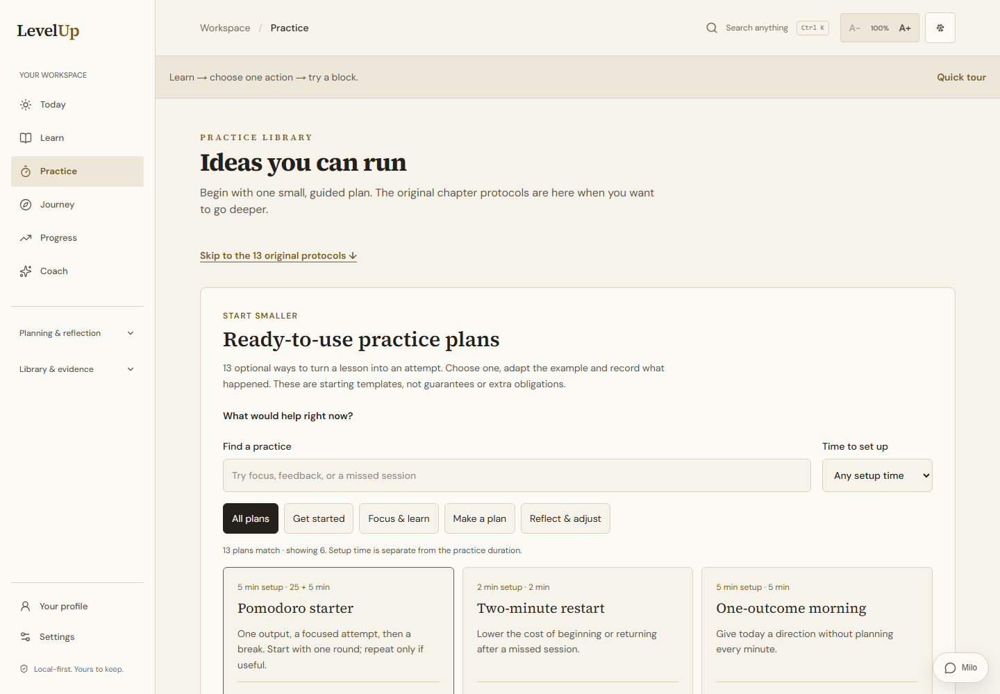
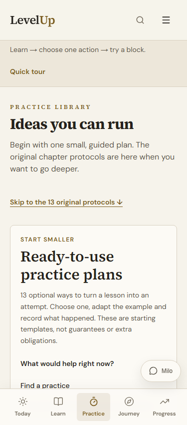

# LevelUp

A place to read something useful, pick one thing to try, and keep track of what happened.

[Open LevelUp](https://hustlenix.github.io/LevelUp/)

The project started with a long self-development video and a question: what do you actually do after watching it? It grew into a 28-chapter manual, then a set of tools for turning those lessons into small actions. There are goals, habits, focus timers, reviews, and study tools. You can use one part without setting up the rest.





## Where to start

1. Open **Small Steps** and write one action, or save a step from a chapter.
2. Try a short focus block. Two minutes counts. You can pause or make the action smaller.
3. Write down what happened and leave yourself a next step.

The **Quick tour** lets you try the flow with sample data before saving anything. Text-size controls go up to 150%, and Settings has instructions for installing the site on your phone or desktop.

## What's in it

- **Learn:** 28 chapters, evidence grades, research notes, quizzes, highlights, and search.
- **Practice:** ready-to-use plans such as a Pomodoro starter and a two-minute restart, alongside the 13 original protocols.
- **Today:** a daily mission plan, saved actions, habits, and a daily ritual. Goals and focus sessions are available through Tools.
- **Journey and Profile:** skill paths, mission evidence, and achievements built from recorded work.
- **Small Steps:** one current task, short timers, a place to park distractions, and a note for when you return.
- **Review:** a record of your sessions, reading, and progress.
- **Study Mode:** subjects, revision, and student planning tools.

The chapters are a starting point for trying ideas, not a promise that every claim is settled science. The audit and research pages show the evidence behind them.

## Milo

Milo is the little companion in the corner. Reading and focus events affect its behaviour, and milestones add objects to its room. That part runs locally with a deterministic event reducer. It doesn't need an AI service, and taking a break doesn't punish the companion.

You can turn Milo off, reduce its motion, or mute its dialogue and sound. There's also a disposable demo in Companion Space if you want to see the room change without editing your progress.

The **Talk** tab has preset offline guidance. Optional cloud chat has a separate Hack Club backend; it is disabled by default and still needs provider approval and a live quality check before public use. You choose which task or progress summary to attach, preview it, and approve any suggested action before it is saved. Chat doesn't award XP or unlock room objects.

[Companion engine](docs/COMPANION-ENGINE.md) · [Milo backend setup and limits](docs/milo-release.md)

## Your data

Core features work without an account. Progress is stored in your browser, and there are no analytics or advertising trackers. Export a backup if you want to keep it safe or move devices; clearing browser storage can erase your record.

Mission progress uses Nexus, a local operation log that reconciles open tabs and keeps an IndexedDB mirror. The [Sync Lab](https://hustlenix.github.io/LevelUp/sync-lab/) lets you inspect the log, try two offline replicas, and export an encrypted packet to move progress yourself. [Protocol notes](docs/NEXUS-PROTOCOL.md) explain what it can and cannot sync.

Previously visited pages can work offline after the production site's service worker has loaded. Optional cloud chat needs a connection and sends your message, recent conversation, and selected context to the provider. Its retention policies are separate from LevelUp's local storage.

## Run locally

Use Node.js 24. The content build uses Node's built-in SQLite support.

```bash
git clone https://github.com/Hustlenix/LevelUp.git
cd LevelUp
npm ci
npm run dev
```

Open [localhost:3000](http://localhost:3000). No API key is needed for the core app.

For a production preview:

```bash
npm run build
npm start
```

The frontend is a Next.js static export deployed to GitHub Pages at `/LevelUp`. The optional Milo backend lives in `services/milo` and is deployed separately. Server secrets belong there, never in `NEXT_PUBLIC_` variables. See [.env.example](.env.example) for public frontend settings.

## Working on it

The app uses Next.js 16, React 19, TypeScript, and Tailwind CSS v4. MiniSearch handles search. A Node/SQLite build script turns the content into JSON for the static site. Browser stores use versioned schemas, and backups are validated before restore.

```bash
npm run lint
npm test
npm run build
node --test services/milo/tests/chat.test.mjs
```

For browser checks, install Chromium with `npx playwright install chromium`, serve the production export, then run:

```bash
node verify-small-steps.mjs http://localhost:3000
node verify-connected-practice.mjs http://localhost:3000
node verify-milo-release.mjs http://localhost:3000
node verify-editorial.mjs http://localhost:3000
```

[Small Steps notes](docs/small-steps.md) · [Practice flow](docs/connected-practice.md) · [Devlog](https://hustlenix.github.io/LevelUp/devlog/)

This project has been built with AI assistance, including Codex. The devlogs document implementation details, tests, and remaining gaps. Local test results don't mean the optional cloud service has been deployed or tested live.

See [LICENSE](LICENSE) for reuse terms.
